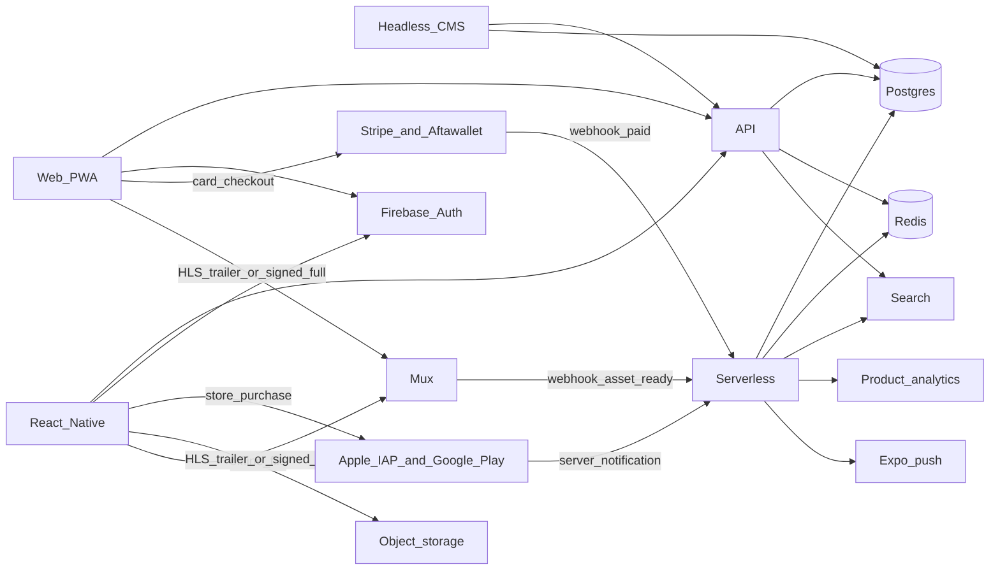

# OMusiki

OMusiki (shown in the interface as Ô musiki) is a French-language web app for streaming African music. It is a place to discover and listen to sounds from across the continent, from Makossa and other regional styles to contemporary hits.

Listeners can:

- Browse albums, regional charts, Afro trends, featured artists, new releases, personalized playlists, genres, and music by country
- Play tracks
- Search the catalog
- Keep a library and favorites
- Download music for offline listening
- Choose a Free, Premium, or Family plan

The interface is in French. The catalog centers on African styles such as Makossa, Bikutsi, Afrobeat, Highlife, Soukous, Rumba, Coupé-Décalé, and Ndombolo.

## Architecture

The web app, the React Native app, the API, a headless CMS, and serverless functions live in one monorepo. Postgres stores the records. Redis caches catalog responses and holds short-lived playback and download grants. Meilisearch serves catalog search. Mux stores the audio and video and serves HLS. Object storage holds artwork and offline files.

### Monorepo

- `apps/web` — the subscriber web app. Playback, search, and Stripe checkout.
- `apps/mobile` — one Expo / React Native codebase, built for Apple and Android. Store billing, streaming, and offline downloads.
- `apps/cms` — the artist and administrator backoffice, on Firebase Auth. An administrator creates each artist. The API generates a temporary password, emails it with a link to choose a new password, and the artist then signs in to manage their account and their titles.
- `apps/api` — the client-facing service. Node, TypeScript, Express, and Prisma. The web and mobile apps reach the platform only through this API.
- `apps/functions` — serverless handlers for Mux, Stripe, Apple, and Google webhooks, plus search indexing, push, and analytics.
- `packages/types` — request and response types shared by the web app, the mobile app, the CMS, the API, and the functions.

### What the API owns

- Catalog reads and search queries. A function updates the search index when a title is approved or changed.
- Profile updates. Sign-up and sign-in with email, Google, and Apple stay with Firebase Auth. The API checks the Firebase ID token and stores the Firebase user id, the role, and the profile fields. An artist or administrator role is the trusted custom claim `role`.
- Mux upload URLs for the trailer and the full title. The media bytes go to Mux.
- Public trailer playback. Anyone can watch a trailer.
- A short-lived signed playback token for the full title when the title is free, the viewer has an active subscription, or the viewer has paid the title fee.
- A short-lived offline download URL for an entitled full title. The React Native app stores the file and plays it without a network connection until the entitlement expires.
- The play log: one row per listen, with the user, the title, the seconds heard, and the time. That log is the artist play counter.

Mux, Stripe, and store secrets stay on the API and the functions.

An administrator defines a small set of subscription plans. An administrator or an artist assigns a title to free, to a subscription, or to a one-time price tier. Each tier is registered in advance as a Stripe Price, an App Store product, and a Google Play product. One entitlement row unlocks full playback on the web and in the app. Its source is `stripe`, `apple`, or `google`.

### Platform

- Payload for the artist and administrator backoffice.
- Redis for cache, rate limits, and short-lived grants.
- Meilisearch for title, artist, and genre search.
- Serverless functions for webhooks and background work.
- Mixpanel for product events such as views, searches, trailer plays, full plays, and purchases.
- Mux for ingest, transcoding, and HLS. A webhook writes each asset id and playback id back onto the title.
- Firebase Auth for email, Google, and Apple on the web, the CMS, and the React Native app. The API verifies ID tokens with the Firebase Admin SDK.
- Stripe Checkout on the web for card subscriptions and one-time title purchases. Aftawallet on the web for prepaid mobile-money passes.
- Apple In-App Purchase and Google Play Billing in the React Native app, for the same plans and price tiers.
- Expo push when a title is approved.

The mobile app sells access through Apple and Google. Stripe Checkout remains the card payment on the web. The in-app Stripe Payment Sheet is outside this version.
